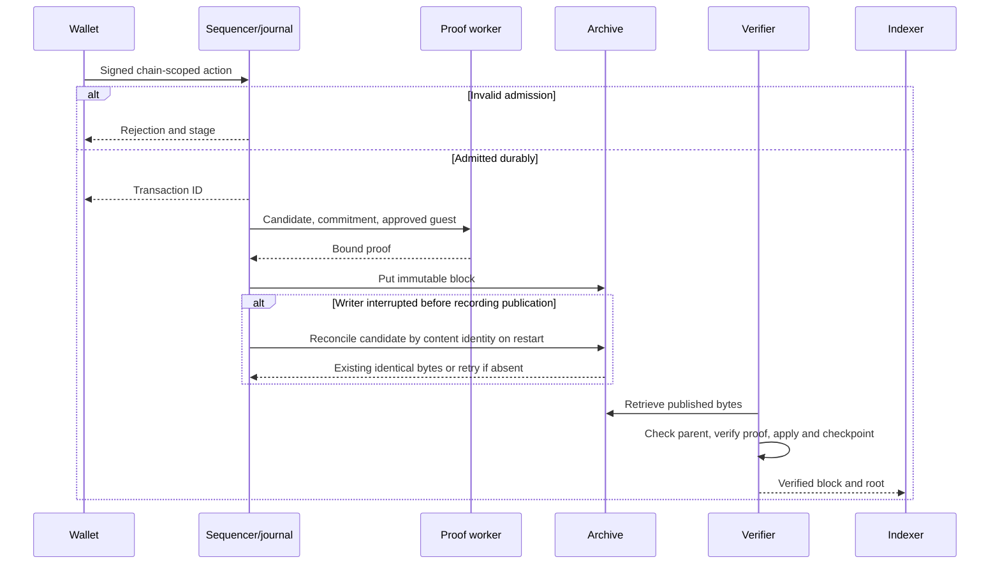

# Who can attest to a transaction?

This contract governs the connected runtime. At the original MVP boundary,
`SubmitTxResponse::Pending` acknowledges an in-memory queue only. It must not
be presented as durable admission until the journal in #124 is implemented.

| Observation | Authority | Evidence required before reporting it |
|---|---|---|
| Unknown | Receipt service | No record at the disclosed lookup height; never infer rejection from an index miss. |
| Admitted | Single sequencer writer | Signed bytes and chain-scoped transaction ID committed to the admission journal before acknowledgement. Retry returns the same ID. |
| Published | Publisher | Archive acknowledges immutable bytes for a block containing the transaction; the journal records the block reference. A proof job result alone is insufficient. |
| Verified | Independent verifier | Header continuity, scheduled guest, proof and transition accepted; height, root and transaction inclusion committed together. |
| Rejected | Admission service or transition executor | Stable reason and stage. An invalid request has no claim on the ID of a different valid signed transaction. Transient worker/provider failures remain pending. |

## Trust boundaries

The wallet signs an action for one chain, account and nonce. Authentication at
the gateway is not authorization: the STF evaluates signer authority, capability
scope and the policy active for execution. The UI must identify that policy;
if an action requires binding an exact version, encode and validate it in the
signed protocol before offering that guarantee. Never silently re-sign on retry.

The sequencer orders actions but cannot attest independent verification. The
worker sees private witnesses; neither witnesses nor keys belong in receipts.
The archive can withhold bytes and is not trusted to certify their content.
The verifier selects the guest by the schedule at the candidate height. The
indexer is a replayable projection: every read reports its cursor independently
of verified height. Index edits must never authorize a transition. An operator
may pause service but may not promote a receipt by manually editing its status.

Protocol reviewers should check replay, fork activation and the crash window;
product reviewers should check that each status describes only its stated
evidence. Record review decisions on #118 before adopting the contract.
